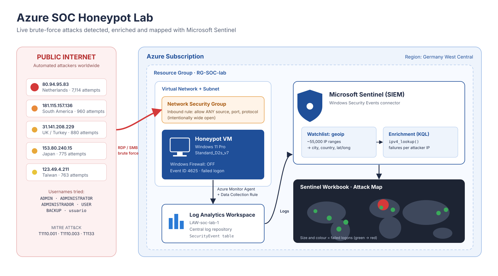
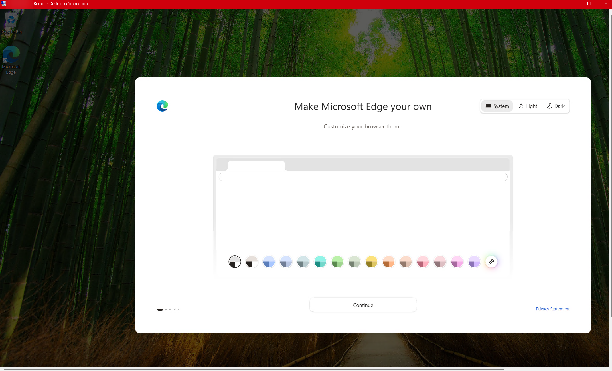
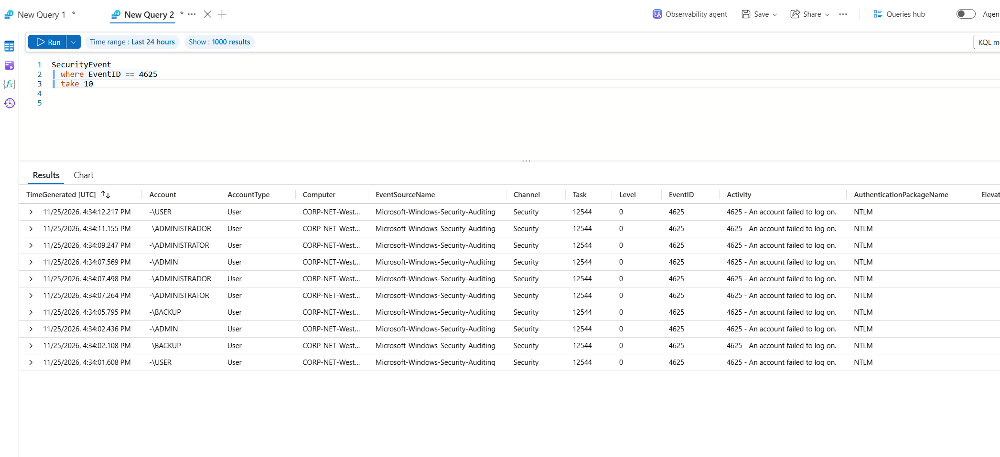
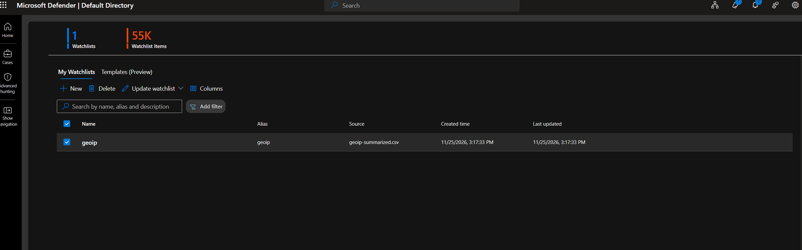
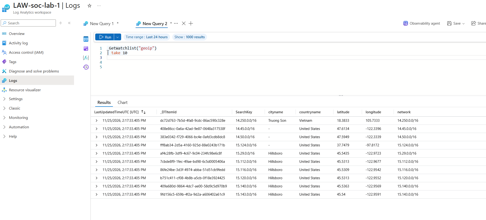
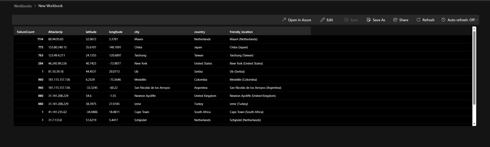

# Azure SOC Honeypot Lab with Microsoft Sentinel


## What this is

For this lab, I set up a Windows virtual machine in Azure and left it open to the internet on purpose, so it would get attacked. I then sent its security logs to Microsoft Sentinel, looked into the failed login attempts with KQL, added location data to each attacker's IP address, and plotted the results on a map.

Within a day, the VM had logged thousands of real login attempts from several countries. This page walks through how I built it, what I found, and the problems I ran into along the way.

**Tools used:** Microsoft Azure, Microsoft Sentinel, Log Analytics, Azure Monitor Agent, KQL, Sentinel watchlists and workbooks, Windows Event Logs.

## How it's set up



| Part | Name | What it does |
|---|---|---|
| Resource group | `RG-SOC-Lab` | Holds everything for the lab |
| Virtual network | `VNet-soc-lab` | The network the VM sits in |
| Virtual machine | `CORP-NET-West-1` (Windows 11 Pro, `Standard_D2s_v7`) | The honeypot |
| Network security group | `CORP-NET-West-1-nsg` | Azure's firewall for the VM, opened to all traffic on purpose |
| Log Analytics workspace | `LAW-soc-lab-1` | Where the logs are stored |
| Data collection rule | `DCR-Windows` | Tells the agent on the VM to send security events to the workspace |
| Microsoft Sentinel | Connected to `LAW-soc-lab-1` | Used for queries, enrichment and the map |
| Watchlist | `geoip` (about 55,000 IP ranges) | Matches IP ranges to a city, country and coordinates |

Everything runs in the **Germany West Central** region.


## How I built it

### 1. The honeypot VM
I created the resource group, virtual network and a Windows 11 VM. I gave it a normal-sounding company name (`CORP-NET-West-1`) rather than anything that would give away that it's a honeypot.

To make it easy to find, I replaced the default network rule (which only allows remote desktop) with one that allows any traffic from anywhere. I also logged in over RDP and turned off the Windows Firewall. I then checked I could reach the VM from my own computer with `ping`.



### 2. Looking at the logs on the VM itself
Before connecting anything to Sentinel, I failed a few logins on purpose with a fake username and opened **Event Viewer > Windows Logs > Security**. Failed logins show up as **Event ID 4625**, along with the username that was tried and the IP address it came from.

### 3. Sending the logs to Sentinel
I created the Log Analytics workspace, turned on Microsoft Sentinel for it, and installed the **Windows Security Events** solution from the Content Hub. A data collection rule installed the Azure Monitor Agent on the VM, which forwards its security events to the workspace. Once data started arriving in the `SecurityEvent` table, I knew the connection worked.

### 4. Looking at the failed logins

```kql
SecurityEvent
| where EventID == 4625
| project TimeGenerated, Account, Computer, EventID, Activity, IpAddress
```



### 5. Adding location data
The logs only contain IP addresses, not locations. To fix that, I uploaded a GeoIP list to Sentinel as a watchlist (alias `geoip`, search key `network`) and checked it loaded:

```kql
_GetWatchlist("geoip")
| take 10
```





Then I matched each attacker's IP to its range in the watchlist and counted the failures per IP:

```kql
let GeoIPDB_FULL = _GetWatchlist("geoip");
SecurityEvent
| where EventID == 4625
| evaluate ipv4_lookup(GeoIPDB_FULL, IpAddress, network)
| summarize FailureCount = count() by IpAddress, latitude, longitude, cityname, countryname
| project FailureCount, AttackerIp = IpAddress, latitude, longitude, city = cityname, country = countryname, friendly_location = strcat(cityname, " (", countryname, ")")
```



### 6. The attack map
I put that query into a Sentinel workbook and switched the view to a map. Each dot is an attacker's location, and its size and colour depend on how many times they tried.


### 7. Checking whether anyone got in
Counting failures only shows how busy the attackers were. The more important question is whether any of them succeeded, so I looked for successful logins (Event ID 4624) from IPs that had also failed:

```kql
SecurityEvent
| where EventID == 4624
| where IpAddress in ((SecurityEvent | where EventID == 4625 | distinct IpAddress))
```

This returned 12 results, but all of them were `ANONYMOUS LOGON`. Windows records these as successful, but they use no username or password and don't give access to any account. They're typically scanners probing the machine. After filtering them out, nothing was left:

```kql
SecurityEvent
| where EventID == 4624
| where IpAddress in ((SecurityEvent | where EventID == 4625 | distinct IpAddress))
| where Account !contains "ANONYMOUS"
| where IpAddress !in ("-", "", "127.0.0.1", "::1")
| project TimeGenerated, Account, LogonType, IpAddress
```

So none of the attackers logged into a real account.

## What I found (25 November 2026)

| Attacker IP | Location | Failed logins |
|---|---|---|
| 80.94.95.83 | Maarn, Netherlands | 7,114 |
| 181.115.157.136 | Colombia or Argentina (see note) | 960 |
| 31.141.208.229 | United Kingdom or Turkey (see note) | 880 |
| 153.80.240.15 | Chiba, Japan | 775 |
| 123.49.4.211 | Taichung, Taiwan | 763 |
| 46.245.99.226 | New York, United States | 284 |

- **It didn't take long.** Automated tools found the VM and started guessing passwords on the same day it went online.
- **One IP did most of the work.** The address in the Netherlands made more attempts than all the others put together, which is what you'd expect from an automated brute-force tool.
- **The usernames were generic.** Attackers tried `ADMIN`, `ADMINISTRATOR`, `ADMINISTRADOR`, `USER`, `BACKUP` and `usuario`. Nobody was targeting a real person. They were working through default account names, in more than one language.
- **No real account was accessed.** The only "successful" logins from attacking IPs were anonymous logons (see step 7).
- **A note on the locations:** two IPs show up in two different countries each. That comes from overlapping ranges in the GeoIP list, not from two separate attackers. IP geolocation is approximate, so I wouldn't rely on it alone to say where an attack really came from.

### MITRE ATT&CK

| Technique | ID | Why it fits |
|---|---|---|
| Brute Force: Password Guessing | T1110.001 | Thousands of failed logins from single IPs |
| Brute Force: Password Spraying | T1110.003 | Many common usernames tried from the same sources |
| External Remote Services | T1133 | Login attempts against a Windows machine exposed to the internet |

## What I'd do on a real system

1. **Don't expose RDP to the internet.** Limit access in the network security group to known IP addresses, or use Azure Bastion or a VPN.
2. **Keep the Windows Firewall on** and only open the ports that are actually needed.
3. **Use strong passwords, account lockout and MFA**, and rename or disable default accounts like `Administrator`.
4. **Block IPs that are clearly attacking**, starting with the busiest one above.
5. **Alert automatically.** A Sentinel analytics rule could open an incident whenever one IP fails to log in many times in a short period.

## Problems I ran into

- **The VM size from the tutorial wasn't available.** `Standard_D2s_v3` was blocked for my subscription, so I used the size list to find one that was allowed and picked `Standard_D2s_v7`.
- **No Windows 10 image.** Windows 10 reached end of support in October 2025, so I used Windows 11 Pro. Logging and the agent work the same way.
- **Region.** I used Germany West Central instead of East US 2, and kept every resource in that same region.
- **KQL mistakes.** I learned the hard way that every step after the table name needs a pipe (`|`), that a semicolon at the very end of a query causes "No tabular expression statement found", and that a backslash inside quotes has to be written twice (`\\`).
- **JSON in the wrong box.** The workbook's JSON has to go in the Advanced Editor. Pasting it into the normal query box just throws an error.
- **How I debugged.** When the map wouldn't work, I tested each part separately (the watchlist, then the failed logins, then the full query) until I found the step that was failing.

## Keeping costs down

I stop the VM from the Azure portal when I'm not using it, since shutting down Windows from inside the VM doesn't stop the billing. Everything is in one resource group, so the whole lab can be deleted in one step.

## Ideas for extending this lab

- A Sentinel analytics rule that opens an incident for repeated failed logins, worked through from start to finish.
- A playbook that blocks attacking IPs automatically.
- A Linux VM alongside the Windows one, to compare their attacks (for example SSH brute force).

## Credits

This lab is based on Josh Madakor's Azure SOC honeypot tutorial on YouTube. The setup choices, troubleshooting, findings and write-up are my own.
