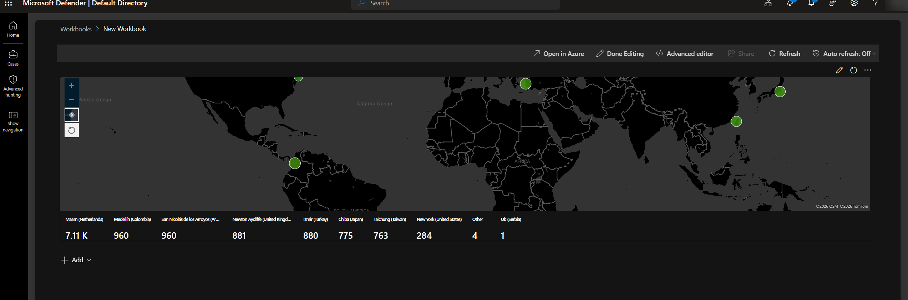
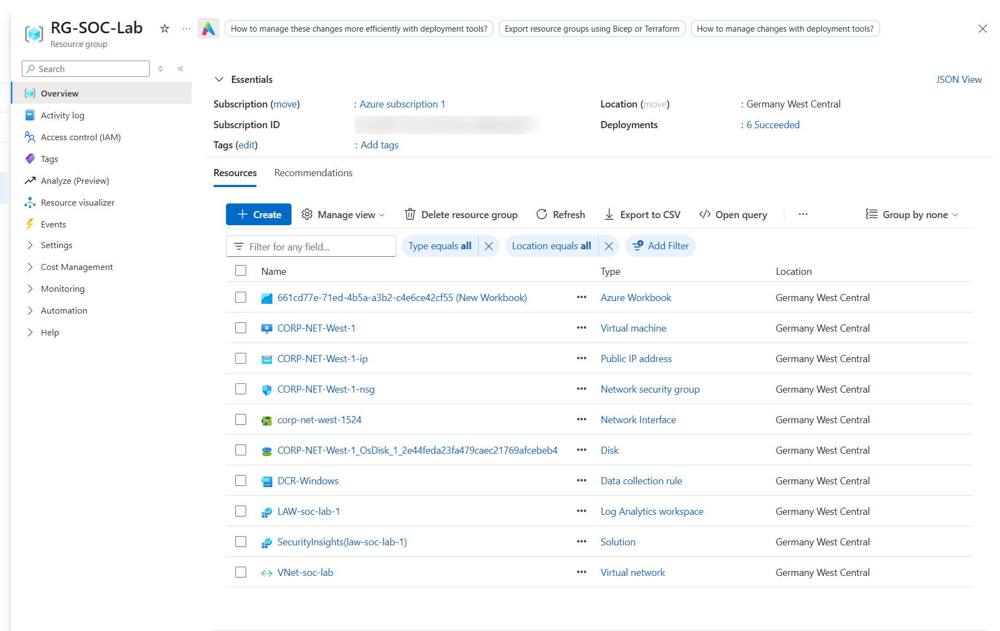

# Azure SOC Honeypot Lab: Detecting and Mapping Live Brute-Force Attacks with Microsoft Sentinel



## Overview

In this project, I built a small cloud Security Operations Center (SOC) in Microsoft Azure. I deployed a Windows virtual machine, deliberately exposed it to the internet as a honeypot, and forwarded its security logs to Microsoft Sentinel (SIEM). Within hours, the VM received thousands of real brute-force login attempts from around the world. I then used KQL to investigate the attacks, enriched the logs with geolocation data, and built a live attack map in a Sentinel workbook.

**Skills demonstrated:** Azure networking, Windows event logging, log forwarding with the Azure Monitor Agent, Log Analytics, Microsoft Sentinel, KQL, threat enrichment with watchlists, data visualisation, troubleshooting, and cloud cost management.

## Architecture


| Component | Name | Purpose |
|---|---|---|
| Resource group | `RG-SOC-Lab` | Container for all lab resources |
| Virtual network and subnet | `VNet-soc-lab` | Network for the honeypot VM |
| Virtual machine | `CORP-NET-West-1` (Windows 11 Pro, `Standard_D2s_v7`) | Honeypot exposed to the internet |
| Network security group | `CORP-NET-West-1-nsg` with an allow-any inbound rule | Cloud firewall opened to all traffic on purpose |
| Log Analytics workspace | `LAW-soc-lab-1` | Central log repository |
| Data collection rule | `DCR-Windows` (Windows Security Events via AMA) | Forwards VM security logs to the workspace |
| Microsoft Sentinel | Connected to `LAW-soc-lab-1` | SIEM for querying, enrichment and the workbook |
| Watchlist | `geoip` (about 55,000 IP ranges) | Maps IP ranges to city, country and coordinates |

**Region:** Germany West Central



## Steps

### 1. Deploy the honeypot VM
- Created the resource group, virtual network and a Windows VM with a neutral, corporate-style hostname so it would not look like a honeypot.
- Replaced the default RDP-only inbound rule in the network security group with a rule allowing **any source, any port, any protocol**.
- Logged in over RDP and disabled the Windows Defender Firewall on all profiles (`wf.msc`).
- Confirmed the VM was reachable from the internet with `ping`.


### 2. Inspect raw logs on the VM
- Generated a few failed logins with a fake username, then opened **Event Viewer > Windows Logs > Security**.
- Filtered for **Event ID 4625** (an account failed to log on) to see the username, logon type and source IP of each failure.

### 3. Forward logs to the SIEM
- Created the Log Analytics workspace and enabled Microsoft Sentinel on it.
- Installed the **Windows Security Events** solution from the Sentinel Content Hub.
- Created a **data collection rule** that installed the Azure Monitor Agent on the VM and forwarded all security events.
- Verified ingestion by querying the `SecurityEvent` table.

### 4. Investigate the attacks with KQL

Failed logons:

```kql
SecurityEvent
| where EventID == 4625
| project TimeGenerated, Account, Computer, EventID, Activity, IpAddress
```


### 5. Enrich the logs with geolocation
- Uploaded a GeoIP list to Sentinel as a watchlist with the alias `geoip` and `network` as the search key.
- Verified the watchlist:

```kql
_GetWatchlist("geoip")
| take 10
```


- Joined failed logons to the watchlist by IP range:

```kql
let GeoIPDB_FULL = _GetWatchlist("geoip");
SecurityEvent
| where EventID == 4625
| evaluate ipv4_lookup(GeoIPDB_FULL, IpAddress, network)
| summarize FailureCount = count() by IpAddress, latitude, longitude, cityname, countryname
| project FailureCount, AttackerIp = IpAddress, latitude, longitude, city = cityname, country = countryname, friendly_location = strcat(cityname, " (", countryname, ")")
```


### 6. Build the attack map
- Created a Sentinel workbook with the query above, set the visualisation to **Map**, plotted by latitude and longitude, sized and coloured by `FailureCount` (green to red heatmap), and labelled by `friendly_location`.


## Findings (25 November 2026, last 24 hours)

| Attacker IP | Location | Failed logons |
|---|---|---|
| 80.94.95.83 | Maarn, Netherlands | 7,114 |
| 181.115.157.136 | Colombia / Argentina (see note) | 960 |
| 31.141.208.229 | United Kingdom / Turkey (see note) | 880 |
| 153.80.240.15 | Chiba, Japan | 775 |
| 123.49.4.211 | Taichung, Taiwan | 763 |
| 46.245.99.226 | New York, United States | 284 |

**Key observations**
- **Attacks began quickly.** Automated scanners found the VM and started guessing passwords within a short time of it being exposed.
- **One source dominated.** A single IP in the Netherlands was responsible for more failed logons than all other sources combined, which is typical of an automated brute-force tool.
- **Usernames targeted:** `ADMIN`, `ADMINISTRATOR`, `ADMINISTRADOR`, `USER`, `BACKUP` and `usuario`. Attackers tried default and generic account names in several languages, rather than targeting real users.
- **Attack method:** network logons (logon type 3) over NTLM, consistent with RDP and SMB password-guessing tools.
- **Data quality note:** two IPs mapped to two different countries each. This comes from overlapping network ranges in the GeoIP watchlist, not from two separate attackers. In a real SOC, I would verify locations against a threat intelligence source before reporting them.

### MITRE ATT&CK mapping

| Technique | ID | Evidence |
|---|---|---|
| Brute Force: Password Guessing | T1110.001 | Thousands of failed logons from single IPs |
| Brute Force: Password Spraying | T1110.003 | Many generic usernames tried from the same sources |
| External Remote Services | T1133 | Attempts to log in to an internet-exposed Windows host |

## Recommendations (if this were a production system)

1. **Never expose RDP directly to the internet.** Restrict inbound traffic in the NSG to known IP addresses, or use Azure Bastion or a VPN.
2. **Keep the host firewall enabled** and allow only required ports.
3. **Enforce strong passwords, account lockout and MFA**, and rename or disable default accounts such as `Administrator`.
4. **Block known malicious IPs**, starting with the top source above.
5. **Automate detection:** create a Sentinel analytics rule that raises an incident when one IP produces more than a set number of 4625 events in a short window.

## Challenges and how I solved them

- **VM size unavailable for my subscription.** The tutorial's size (`Standard_D2s_v3`) was blocked in my region. I used the size picker to find an available size and chose `Standard_D2s_v7`.
- **Windows 10 image not available.** Windows 10 reached end of support in October 2025, so I used Windows 11 Pro. Security event logging and the agent work the same way.
- **Region choice.** I deployed in Germany West Central instead of East US 2, keeping all resources in the same region.
- **KQL syntax errors.** I learned that every operator after the table name needs a pipe (`|`), that a trailing semicolon after the final statement causes "No tabular expression statement found", and that backslashes in strings must be escaped (`\\`).
- **Workbook JSON vs KQL.** Pasting the workbook JSON into the query box fails; JSON belongs in the Advanced Editor, while the query box only accepts KQL.
- **Debugging method.** I isolated the problem by testing each part separately: the watchlist, then the failed-logon data, then the full join.

## Cost management

- Enabled auto-shutdown on the VM and stopped (deallocated) it after the lab.
- Kept everything in one resource group so the whole lab can be deleted in a single step.

## Next steps

- Create analytics rules and incidents in Sentinel and work an incident from detection to closure.
- Add a playbook (Logic App) to block attacking IPs automatically.
- Extend the lab with a Linux VM and compare attack patterns (for example SSH brute force).

## Credits

Based on the Azure SOC honeypot lab tutorial by Josh Madakor on YouTube. The configuration choices, troubleshooting, findings and analysis above are my own.
